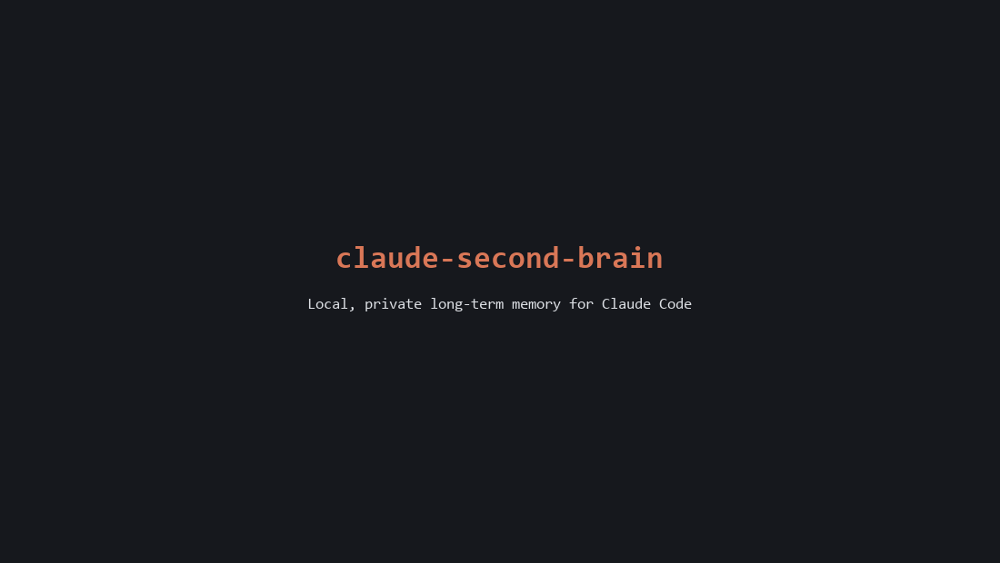
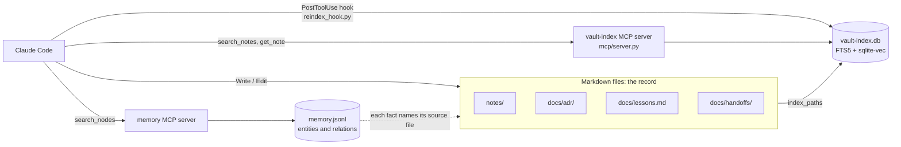
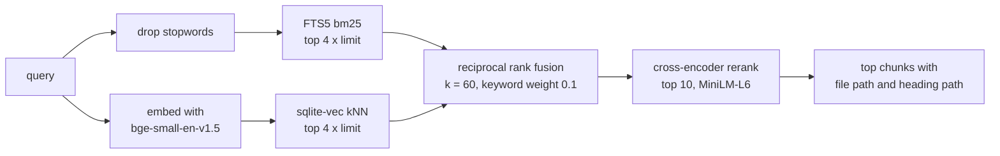

# claude-second-brain

[](https://github.com/GitGudatCodeing/claude-second-brain/actions/workflows/ci.yml)

[](https://pypi.org/project/vault-index/)


A local, private long-term memory for [Claude Code](https://claude.com/claude-code). Your markdown notes stay the record. Claude searches them through a hybrid keyword + vector index, writes decisions and lessons back as plain files, and hooks keep the index, the knowledge graph and long sessions in check.

Everything runs on your machine: one SQLite file, two small CPU models, no cloud services.



<sub>Terminal replay of real output from a fresh clone of v0.1.0 with the sample vault (eval then had 32 questions); only the typing animation is added.</sub>

## Why
Claude Code forgets everything between sessions. The usual fixes are a huge `CLAUDE.md` (expensive on every turn) or a vector store nobody can read or fix. This project takes a different line:

- **Files are the truth.** Notes, decision records and lessons are markdown you can read, edit and version. The index and the graph can be rebuilt from them at any time.
- **Search before guessing.** Claude is told to search the vault before answering about past work, and gets a tool that actually finds paraphrased answers.
- **Measured, not vibes.** Every search change is scored against a golden set and kept only if it beats the baseline. The experiments that failed are documented too.
- **Self-checking.** At session start, invariants verify that each pipeline still reaches its consumer, so silent breakage shows up the same day.

## How it works



| Hook | Script | What it does |
|---|---|---|
| SessionStart | `scripts/invariants.py --hook` | 10 checks: MCP servers launchable, graph sources exist, index fresh, hooks wired, golden labels valid, lessons well-formed, context budget. |
| PostToolUse (Write, Edit) | `mcp/reindex_hook.py` | Re-indexes the edited file if it sits under a registered source. Never blocks. |
| UserPromptSubmit, PostToolUse (async) | `scripts/context_guard.py` | Reads the real context size from the transcript. Silent until 250k tokens (`.claude/handoff.json`), then requires `/handoff`: a note plus a card to start the fresh session. On every prompt, and once per session mid-turn. |
| PreCompact | `scripts/precompact_snapshot.py` | Saves recent requests and touched files to `docs/handoffs/auto/` as a fallback before compaction. |

### Search



- Markdown is chunked by heading (up to about 1,200 characters), so every hit carries a path like `Recipe box data model > Units`.
- Indexing is incremental: unchanged files are skipped by mtime and content hash; deleted files are dropped on the next sync.
- Keyword ranks count at a tenth of vector ranks: they break ties and lift exact terms (ids, tool names) without outvoting meaning.
- A small cross-encoder (`ms-marco-MiniLM-L-6-v2`, 80 MB) then reorders the top 10 by reading query and chunk together. It adds about 200 ms per search on CPU; `VAULT_RERANK=0` turns it off.
- A per-folder `.indexignore` keeps tooling code out of results.

MCP tools: `index_paths`, `search_notes`, `get_note`, `list_sources`, `remove_source`.

## Commands

| Command | What it does |
|---|---|
| `/recall <topic>` | Searches notes, lessons and the graph together and answers with clickable sources. Read-only. |
| `/adr <title>` | Writes a decision record to `docs/adr/` and links it in the graph. |
| `/learn <what happened>` | Records a lesson as a testable directive (`scripts/learn.py`): lesson, cause, how to detect it. Supersede or retire, never delete. |
| `/ingest <path>` | Indexes a file or folder and adds its durable entities to the graph. |
| `/handoff [topic]` | Writes a handoff note and starts a fresh session from it. |

Installed as a plugin, the commands carry its name: `/second-brain:recall`, `/second-brain:adr` and so on.

## Quickstart
Needs [uv](https://docs.astral.sh/uv/) (it fetches Python 3.10 to 3.13), Node.js for the memory server, and Claude Code.

### As a plugin
In the folder that holds your notes:

```bash
claude plugin marketplace add GitGudatCodeing/claude-second-brain
claude plugin install second-brain@second-brain --scope project
```

Start `claude` there, then ask it to index the folder ("index_paths .") and try `/second-brain:recall <topic>`. The plugin brings the five commands, the hooks (re-index on edit, context guard, pre-compact snapshot) and both MCP servers. Decision records go to `docs/adr/`, lessons to `docs/lessons.md`, handoffs to `docs/handoffs/`, and the knowledge graph to `memory.jsonl`, all inside that folder. The search index is shared at `~/.mcp-memory/vault-index.db`.

`--scope project` keeps the plugin to that folder: the context guard would otherwise run in every project. The plugin leaves out the session-start invariants, which check this repo's layout. Change the handoff limit with a `.claude/handoff.json` like [this repo's](.claude/handoff.json) (default 250k tokens).

Use the plugin or the clone below in a folder, not both: each starts its own `vault-index` server.

### From a clone
The full repo adds the sample vault, the eval and the invariants.

```bash
git clone https://github.com/GitGudatCodeing/claude-second-brain.git
cd claude-second-brain
uv run --project mcp python scripts/setup.py
```

`setup.py` writes `.mcp.json` (memory graph at `~/.mcp-memory/memory.jsonl` unless you pass `--memory-file`), indexes the folder and runs the invariants. Then start `claude` in the folder, approve the project MCP servers and hooks, and try `/recall garden sensor battery life`. Check the wiring any time with `python scripts/invariants.py`.

Your own notes go in `notes/`. Delete `example-vault/` when you no longer need the eval, and update `eval/golden.jsonl` with questions about your own notes.

On Windows, Claude Code runs hooks through Git Bash; the hook commands already use forward slashes.

### Just the search server
`vault-index` is on [PyPI](https://pypi.org/project/vault-index/) and in the [MCP registry](https://registry.modelcontextprotocol.io). To use the hybrid search on any folder of notes without the rest of this repo:

```bash
claude mcp add vault-index -- uvx --python 3.12 vault-index
```

Then ask Claude to index a folder (for example "index_paths ~/notes") and search it with `search_notes`.

It also works from a terminal. Indexing a large vault there first shows progress and keeps Claude's first tool call short:

```bash
uvx --python 3.12 vault-index index ~/notes        # no paths re-syncs every source
uvx --python 3.12 vault-index search "your question" -n 5
uvx --python 3.12 vault-index sources
uvx --python 3.12 vault-index --help
```

With no command it serves MCP over stdio. The index lives in `~/.mcp-memory/vault-index.db`. To move it, set `VAULT_INDEX_DB` in your shell environment rather than only in the MCP config, so the server, the re-index hook and the invariants all use the same file. `--python 3.12` keeps uvx off newer Pythons that the embedding runtime does not support yet.

## Retrieval eval
`example-vault/` is a fictional person's notes, decisions and lessons. `eval/golden.jsonl` has 44 questions about it and about this repo's own docs, worded differently from the notes on purpose, so keyword overlap alone does not find most answers. The last 12 are hard paraphrases that share almost no words with their answer. (Keep golden questions out of indexed files like this README, or they compete with the real answers.)

```bash
VAULT_INDEX_DB=/tmp/csb-eval.db uv run --project mcp python eval/run_eval.py --modes all -v
```

| Mode | NDCG@5 | MRR | Recall@5 |
|---|---|---|---|
| hybrid + rerank (what `search_notes` serves) | 0.747 | 0.797 | 0.780 |
| hybrid, fusion only (no rerank) | 0.686 | 0.724 | 0.758 |
| keyword only (FTS5) | 0.491 | 0.544 | 0.576 |
| vector only | 0.697 | 0.729 | 0.758 |
| naive grep, no index (baseline) | 0.305 | 0.341 | 0.375 |

The grep row ranks chunks by how many query words they contain, roughly what searching with `rg` per word gives you.

Without the reranker, vector-only edged out fusion on the sample vault (the hard paraphrases give keywords nothing to match); the reranker puts hybrid back on top. On the author's private vault (41 questions) the order is the same: hybrid + rerank 0.550, fusion only 0.487, vector 0.473, keyword 0.433, grep 0.327.

### Compared with basic-memory
[basic-memory](https://github.com/basicmachines-co/basic-memory) is a popular markdown memory MCP server with its own hybrid search. `eval/compare_basic_memory.py` runs it (v0.24.1, same bge-small model) on a copy of the same markdown files and scores both on the same 44 questions. basic-memory returns whole notes, so both are scored per file here (vault-index chunks collapsed to their file):

| System (file level) | NDCG@5 | MRR | Recall@5 |
|---|---|---|---|
| vault-index hybrid + rerank | 0.829 | 0.858 | 0.886 |
| basic-memory, default search | 0.619 | 0.611 | 0.750 |
| basic-memory, vector only | 0.708 | 0.736 | 0.814 |

basic-memory does much more than search (it writes notes, builds a graph from them, offers cloud sync); this compares retrieval only. Its default search varied by about 0.005 between runs. It is not run in CI.

CI fails if any hybrid metric drops more than 0.03 below `eval/baseline.json`. Scores are identical on Ubuntu and Windows.

### What worked and what did not
Each change tested alone against a saved baseline, mostly on the author's private vault:

| Change | Effect on NDCG@5 | Kept |
|---|---|---|
| Cross-encoder rerank of the top 10 (MiniLM-L6, 80 MB) | sample +0.061, private +0.063 | yes: about 200 ms per search |
| Larger rerankers (MiniLM-L12, Jina v1 tiny/turbo, bge-reranker-base) | mixed: some lost on the sample set | no |
| Keyword weight 0.1 in the fusion (was 1.0) | private +0.037, sample +0.066 | yes |
| Exclude tooling code (`.indexignore`) | +0.063 | yes |
| Drop stopwords from the FTS query | +0.018 | yes |
| all-MiniLM-L6-v2 instead of bge-small | -0.024 | no |
| Weight headings higher in bm25 (x2 to x10) | -0.015 to -0.036 | no |
| bge-base + query prefix (768 dims) | +0.030, about one question | no: 3x the model for noise-level gain |

With equal weights, vector-only beat hybrid on the sample vault while hybrid won on the private one (jargon needs keywords). A sweep of keyword weight by RRF k on both sets found one setting that wins on both; vector-only is still worse on the private vault, so keywords stay in at a low weight. Details in [`docs/adr/`](docs/adr/).

## Repository layout
```
mcp/            vault-index MCP server and re-index hook
scripts/        invariants, learn.py, context guard, pre-compact snapshot
eval/           golden set, baseline, run_eval.py, compare_basic_memory.py
tests/          pytest suite (fake embedder, no model download)
example-vault/  fictional sample notes for the eval
docs/adr/       decision records for this system
docs/lessons.md lessons learned while building it
.claude/        slash commands, hook settings, handoff thresholds
plugin/         the Claude Code plugin, built from the files above
.claude-plugin/ marketplace listing the plugin
```

## Development
```bash
uv run --project mcp --with pytest pytest tests -q
uvx ruff check .
```

The tests use a fake bag-of-words embedder, so they run in about a second. CI runs lint, tests, the retrieval eval and the invariants on Ubuntu and Windows for every push. See [CONTRIBUTING.md](CONTRIBUTING.md).

## Status
Early and opinionated: built for one person's daily use, then generalised. Tested day to day on Windows 11 with the Claude desktop app; CI covers Ubuntu and Windows. The portable hook commands (`$CLAUDE_PROJECT_DIR`) pass the invariants in CI but have not yet run in a live session on macOS or Linux.

## License
[MIT](LICENSE)
