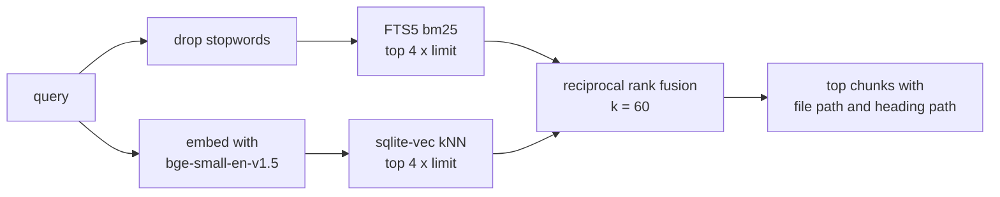

# claude-second-brain

[](https://github.com/GitGudatCodeing/claude-second-brain/actions/workflows/ci.yml)


A local, private long-term memory for [Claude Code](https://claude.com/claude-code). Your markdown notes stay the record. Claude searches them through a hybrid keyword + vector index, writes decisions and lessons back as plain files, and hooks keep the index, the knowledge graph and long sessions in check.

Everything runs on your machine: one SQLite file, a CPU embedding model, no cloud services.

<!-- Demo GIF: see the recording plan; add as docs/demo.gif

-->

## Why
Claude Code forgets everything between sessions. The usual fixes are a huge `CLAUDE.md` (expensive on every turn) or a vector store nobody can read or fix. This project takes a different line:

- **Files are the truth.** Notes, decision records and lessons are markdown you can read, edit and version. The index and the graph can be rebuilt from them at any time.
- **Search before guessing.** Claude is told to search the vault before answering about past work, and gets a tool that actually finds paraphrased answers.
- **Measured, not vibes.** Every search change is scored against a golden set and kept only if it beats the baseline. The experiments that failed are documented too.
- **Self-checking.** At session start, invariants verify that each pipeline still reaches its consumer, so silent breakage shows up the same day.

## How it works

```mermaid
flowchart LR
    subgraph files["Markdown files: the record"]
        notes["notes/"]
        adr["docs/adr/"]
        lessons["docs/lessons.md"]
        handoffs["docs/handoffs/"]
    end

    cc["Claude Code"]
    vi["vault-index MCP server<br/>mcp/server.py"]
    db[("vault-index.db<br/>FTS5 + sqlite-vec")]
    mem["memory MCP server"]
    graph[("memory.jsonl<br/>entities and relations")]

    cc -- "Write / Edit" --> files
    cc -- "PostToolUse hook<br/>reindex_hook.py" --> db
    cc -- "search_notes, get_note" --> vi
    vi --> db
    files -- "index_paths" --> db
    cc -- "search_nodes" --> mem
    mem --> graph
    graph -. "each fact names its source file" .-> files
```

| Hook | Script | What it does |
|---|---|---|
| SessionStart | `scripts/invariants.py --hook` | 10 checks: MCP servers launchable, graph sources exist, index fresh, hooks wired, golden labels valid, lessons well-formed, context budget. |
| PostToolUse (Write, Edit) | `mcp/reindex_hook.py` | Re-indexes the edited file if it sits under a registered source. Never blocks. |
| UserPromptSubmit | `scripts/context_guard.py` | Reads the real context size from the transcript. Suggests `/handoff` at 300k tokens, requires it at 450k (`.claude/handoff.json`). |
| PreCompact | `scripts/precompact_snapshot.py` | Saves recent requests and touched files to `docs/handoffs/auto/` as a fallback before compaction. |

### Search



- Markdown is chunked by heading (up to about 1,200 characters), so every hit carries a path like `Recipe box data model > Units`.
- Indexing is incremental: unchanged files are skipped by mtime and content hash; deleted files are dropped on the next sync.
- A per-folder `.indexignore` keeps tooling code out of results.

MCP tools: `index_paths`, `search_notes`, `get_note`, `list_sources`, `remove_source`.

## Commands

| Command | What it does |
|---|---|
| `/recall <topic>` | Searches notes, lessons and the graph together and answers with clickable sources. Read-only. |
| `/adr <title>` | Writes a decision record to `docs/adr/` and links it in the graph. |
| `/learn <what happened>` | Records a lesson as a testable directive (`scripts/learn.py`): lesson, cause, how to detect it. Supersede or retire, never delete. |
| `/ingest <path>` | Indexes a file or folder and adds its durable entities to the graph. |
| `/handoff [topic]` | Writes a handoff note and starts a fresh session from it. |

## Quickstart
Needs [uv](https://docs.astral.sh/uv/) (it fetches Python 3.10 to 3.13), Node.js for the memory server, and Claude Code.

```bash
git clone https://github.com/GitGudatCodeing/claude-second-brain.git
cd claude-second-brain
uv sync --project mcp
cp .mcp.json.example .mcp.json
```

1. In `.mcp.json`, set `MEMORY_FILE_PATH` to an absolute path, for example `~/.mcp-memory/memory.jsonl` written out in full.
2. Start `claude` in the folder and approve the project MCP servers and hooks.
3. Ask Claude to index the folder: `run index_paths with <absolute path of this folder>`.
4. Try it on the sample vault: `/recall garden sensor battery life`.
5. Check the wiring any time: `python scripts/invariants.py`.

Your own notes go in `notes/`. Delete `example-vault/` when you no longer need the eval, and update `eval/golden.jsonl` with questions about your own notes.

On Windows, Claude Code runs hooks through Git Bash; the hook commands already use forward slashes.

## Retrieval eval
`example-vault/` is a fictional person's notes, decisions and lessons. `eval/golden.jsonl` has 32 questions about it and about this repo's own docs, worded differently from the notes on purpose, so keyword overlap alone does not find most answers. (Keep golden questions out of indexed files like this README, or they compete with the real answers.)

```bash
VAULT_INDEX_DB=/tmp/csb-eval.db uv run --project mcp python eval/run_eval.py --modes all -v
```

| Mode | NDCG@5 | MRR | Recall@5 |
|---|---|---|---|
| hybrid (what `search_notes` serves) | 0.716 | 0.755 | 0.807 |
| keyword only (FTS5) | 0.583 | 0.646 | 0.672 |
| vector only | 0.773 | 0.797 | 0.865 |

CI fails if any hybrid metric drops more than 0.03 below `eval/baseline.json`. Scores are identical on Ubuntu and Windows.

### What worked and what did not
Experiments on the author's private vault, each tested alone against a saved baseline:

| Change | Effect on NDCG@5 | Kept |
|---|---|---|
| Exclude tooling code (`.indexignore`) | +0.063 | yes |
| Drop stopwords from the FTS query | +0.018 | yes |
| all-MiniLM-L6-v2 instead of bge-small | -0.024 | no |
| Weight headings higher in bm25 (x2 to x10) | -0.015 to -0.036 | no |
| bge-base + query prefix (768 dims) | +0.030, about one question | no: 3x the model for noise-level gain |

Open finding: on the sample vault, vector-only beats hybrid. Keyword matches add noise for paraphrased questions. Fusion weighting is the next experiment. Details in [`docs/adr/`](docs/adr/).

## Repository layout
```
mcp/            vault-index MCP server and re-index hook
scripts/        invariants, learn.py, context guard, pre-compact snapshot
eval/           golden set, baseline, run_eval.py
tests/          pytest suite (fake embedder, no model download)
example-vault/  fictional sample notes for the eval
docs/adr/       decision records for this system
docs/lessons.md lessons learned while building it
.claude/        slash commands, hook settings, handoff thresholds
```

## Development
```bash
uv run --project mcp --with pytest pytest tests -q
uvx ruff check .
```

The tests use a fake bag-of-words embedder, so they run in about a second. CI runs lint, tests, the retrieval eval and the invariants on Ubuntu and Windows for every push. See [CONTRIBUTING.md](CONTRIBUTING.md).

## Status
Early and opinionated: built for one person's daily use, then generalised. Tested day to day on Windows 11 with the Claude desktop app; CI covers Ubuntu and Windows. The portable hook commands (`$CLAUDE_PROJECT_DIR`) pass the invariants in CI but have not yet run in a live session on macOS or Linux.

## License
[MIT](LICENSE)
